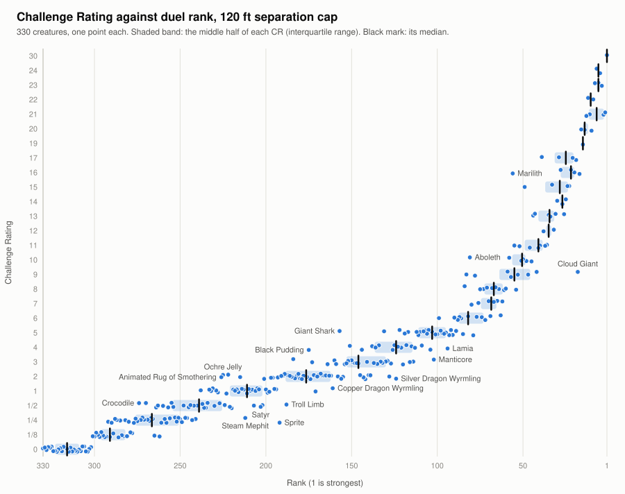

# srd-duel-sim

A Monte Carlo simulator that pits every monster in the System Reference Document 5.2.1 against every other, one on
one, under the 2024 fifth-edition rules. It runs about seven million fights per scenario over all 54,285 pairings of
the 330 stat blocks and ranks the monsters by an Elo rating fitted to the results.



## What the results show

- **Challenge Rating tracks duel strength closely.** The Spearman rank correlation of Elo with CR is 0.984 to 0.985
  in all three scenarios.
- **Some creatures duel well above their CR.** The Cloud Giant (CR 9) ranks 17th to 21st of 330, among CR 16 and 17
  dragons. The Sprite (CR 1/4) is the furthest above the median Elo of its CR, by 573 points at 120 ft.
- **Some duel well below it.** The Giant Shark (CR 5) is furthest below its CR's median (−448 at 120 ft). It
  fights on land, where its printed Speed is 5 ft. The Marilith (CR 16) ranks 56th, among creatures of CR 8 to 11.
- **Room to move matters for some.** The Aboleth ranks 58th when held within 30 ft and 81st with 600 ft of room,
  and the Troll 76th against 103rd; the Manticore goes the other way, 118th against 100th.

These are 1v1 duel results under stated assumptions. A Challenge Rating describes a creature's threat to a party
of adventurers, not its chance in a duel against another monster, so a creature ranked far from its CR is not
evidence that its CR is wrong. The rankings measure one narrow thing, consistently, for all 330 creatures.

## Reading the rankings

[results/RANKINGS.md](results/RANKINGS.md) has every creature's rank, Elo and win rate in each scenario.

- **Rank** is position by Elo within a scenario; 1 is strongest.
- **Elo** is strength fitted to all pairings at once, scaled so the median CR 1 creature is 1000. A 400-point gap
  is 10 to 1 odds.
- **Win** is the creature's average score over its 329 opponents, each opponent counting equally.

[results/](results/) also holds every pairing's raw result, the score matrix, the compiled stat blocks and the
plots; [results/README.md](results/README.md) defines each file and column, and
[results/MANIFEST.md](results/MANIFEST.md) records the commit, the commands and checksums.

## What a duel is

Two creatures start 30 feet apart on open, flat ground. The scenario caps how far apart they may get: `max30` (30
ft), `max120` (120 ft) or `max600` (600 ft), and a flier may rise no higher than that above the other. Each creature
fights with everything its printed stat block gives it, chosen by a consistent expected-value heuristic. A fight
that reaches 100 rounds is a draw.

There is no terrain or cover, no summons, lair actions, allies or surprise, no swimming, and no shape-changing.
[docs/LIMITATIONS.md](docs/LIMITATIONS.md) lists every limit and fixed interpretation;
[docs/METHOD.md](docs/METHOD.md) describes what is modelled, how fights are sampled and scored, and every command.

## Quick start

Requires Node.js 24 or newer; there are no runtime dependencies.

```sh
npm install
npm test
npm run compile
node src/cli.ts fight "Goblin Minion" "Guard" --iters 1000 --seed 1
node src/cli.ts fight "Goblin Minion" "Guard" --seed 3 --verbose
node src/cli.ts analyze --iters 800 --adaptive --pilot 70 --target-se 0.02 --workers 9 --seed 1
```

`compile` writes the compiled stat blocks to `out/`. The first `fight` reports win rates over 1,000 fights; the
second prints one fight turn by turn. `analyze` is the standard sweep (`max30` and `max120`, about 15 minutes on
nine cores); [docs/METHOD.md](docs/METHOD.md#commands) has the `max600` sweep and the rest.

## Character benchmarks

[`pc-pilot/`](pc-pilot/README.md) builds the twelve SRD classes at levels 1, 5, 11 and 17 as stat blocks and
duels each against every SRD monster, to estimate the monster CR it fights like. It is a side experiment: these
blocks are not in the rankings. Its README has the build conventions, the approximations and the results;
`pc-pilot/statblocks/` has the 48 blocks.

## Licence and attribution

The simulator code is MIT-licensed; see [LICENSE](LICENSE). The Python data-extraction tools in `tools/` are
AGPL-3.0-only because they use PyMuPDF; they are needed only to regenerate `data/`.

This work includes material from the System Reference Document 5.2.1 ("SRD 5.2.1") by Wizards of the Coast LLC,
available at https://www.dndbeyond.com/srd. The SRD 5.2.1 is licensed under the Creative Commons Attribution 4.0
International License, available at https://creativecommons.org/licenses/by/4.0/legalcode.

The monster and spell data in `data/` is generated from the SRD 5.2.1 PDF and has been modified; SRD-derived
material, here and in the results, is under CC BY 4.0. [NOTICE.md](NOTICE.md) lists the changes and the
third-party licences. This project is not affiliated with or endorsed by Wizards of the Coast.

Built with substantial AI assistance (Claude Code).
